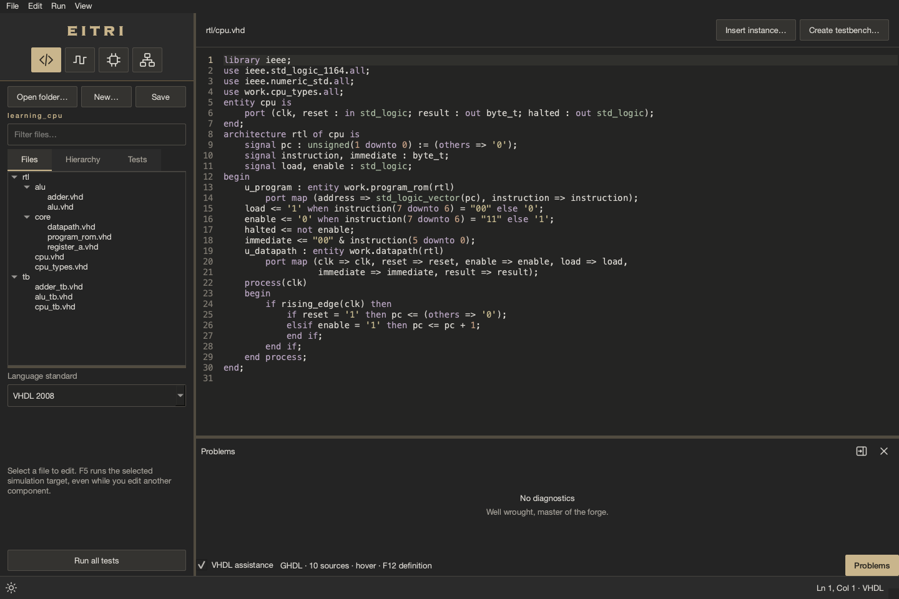
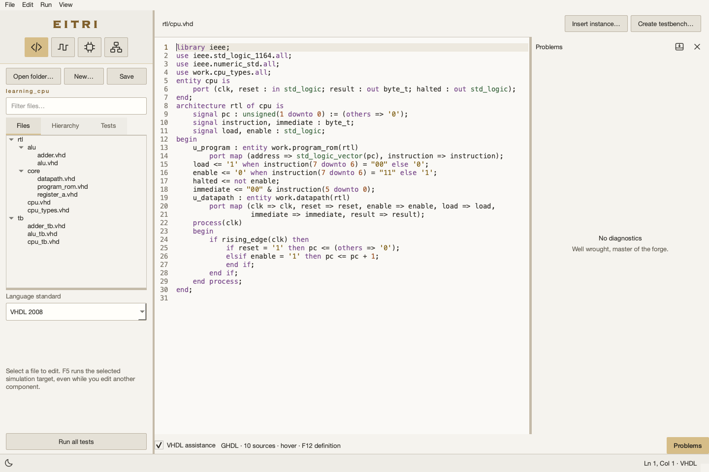
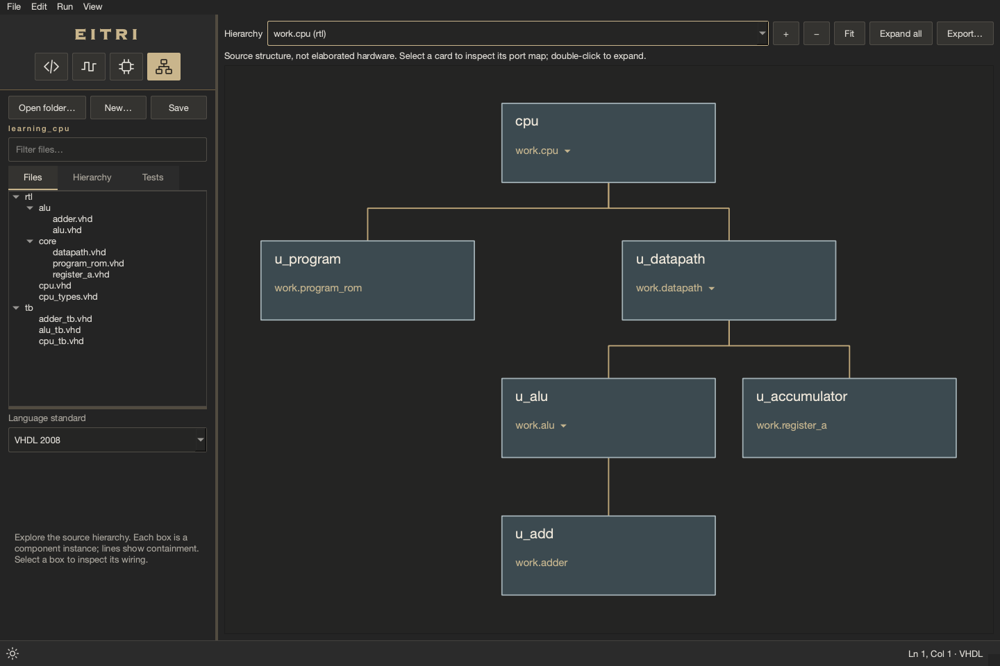
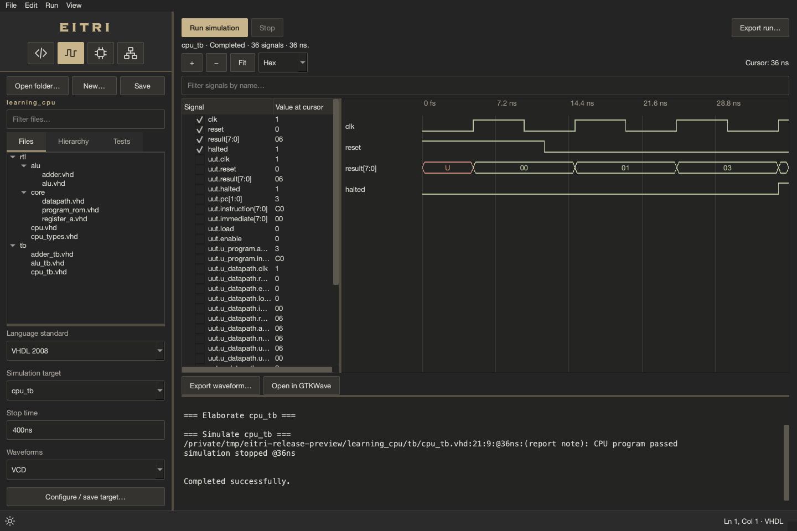
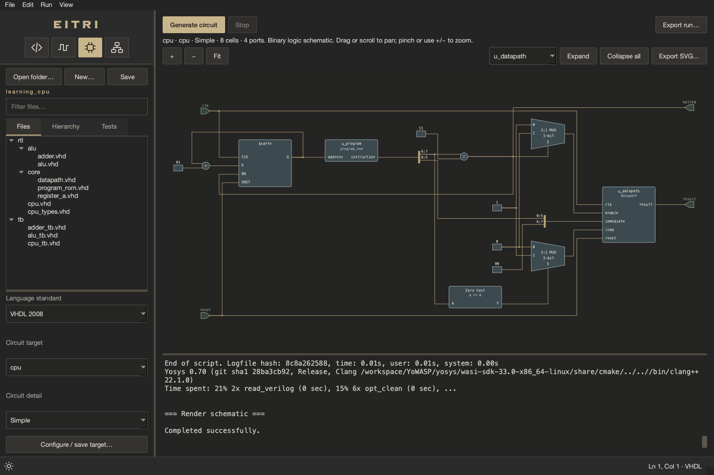
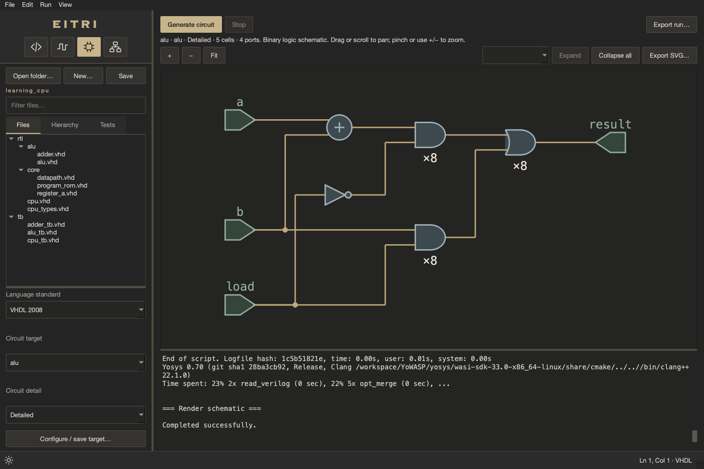

# Eitri

**Learn VHDL by building circuits, not by setting up an FPGA project.** Eitri brings a folder-based editor, simulation, waveforms, circuit diagrams, and component hierarchy navigation into one app. If your goal is to understand digital logic or build a small CPU for class, it gives you a focused place to work before you need a full FPGA suite like Vivado.

- **Follow a design from code to signals to gates.** Run a testbench, inspect its waveforms, then explore the circuit your VHDL describes.
- **Grow from one component to a CPU.** Open a folder, reuse components, and follow their definitions and port maps through an interactive hierarchy diagram.
- **Spend less time repeating setup.** Eitri orders project dependencies, includes unsaved edits in runs, and remembers separate simulation and circuit targets. Edit an adder while keeping the CPU testbench selected.
- **Get help where you write.** VHDL diagnostics, hover information, definition navigation, and instance insertion sit alongside your code. A resizable assistance panel stays where you put it.

Eitri focuses on learning and experimentation. For FPGA device selection, timing closure, bitstream generation, and programming a board, you still need an FPGA implementation toolchain such as Vivado.

## Why Eitri exists

I'm building Eitri as a small, modern VHDL workspace for my school lab assignments.

I wanted to work at home without installing a 30–40 GB Vivado setup full of features I'd never need just to learn VHDL. I couldn't find an alternative that felt both complete enough and modern enough for what I wanted, so I started making my own.

With Eitri, I can write designs and testbenches, reuse components, simulate signals, and see how my code becomes a circuit all in one app. It uses PySide6 for the interface, GHDL for VHDL simulation and synthesis, and Yosys with netlistsvg for circuit diagrams. My focus is learning and experimenting with VHDL, not replacing a complete FPGA implementation toolchain.

## A look inside

These screenshots use the included [tiny learning CPU](examples/learning_cpu/README.md). It runs `LOAD 1`, `ADD 2`, `ADD 3`, then `HALT`, producing a result of 6. Open the example folder to explore it yourself.

### Write and connect components

Switch files in the explorer, insert component instances into an architecture, and inspect VHDL diagnostics without leaving the editor. Tab and Shift+Tab work on selected lines; Backspace removes a whole indentation level at four-column stops in leading whitespace.



Choose light or dark mode with the sun/moon button. Dock assistance below the editor or on its right, drag the divider to resize it, or hide it. Its position and size are remembered, and switching themes keeps your diagnostics visible.



### Understand the hierarchy

Follow the CPU down through its datapath, ALU, and adder. Select a component to inspect its port map, jump to its definition or instance, or generate its circuit. This diagram shows the structure of your source; use the circuit view to inspect synthesized connections.



### Test the behavior

Choose a simulation target and run it independently of the file you're editing. Inspect signals in the built-in waveform viewer, run all testbenches, and follow assertion failures back to source. Export a run with its source snapshot and results when you want to keep or share it.



### Explore the circuit

**Simple** keeps component boundaries and inferred memories readable. Expand individual components when you want to look inside.



**Detailed** expands the hierarchy and inferred memories, and shows multiplexers as AND, OR, and NOT logic. Arithmetic and registers can retain their own symbols; this is an educational circuit view, not a physical FPGA layout. Larger designs are easier to study one component at a time—here is the ALU.



## Install and open a project

Eitri is available on [PyPI as `eitri-hdl`](https://pypi.org/project/eitri-hdl/). It supports Python **3.12–3.15**, with packaged builds for **Windows x64, Linux x64, and macOS Apple Silicon**. The compiler, simulator, language server, and circuit-generation tools are included or installed as dependencies; you do not need a separate Vivado installation.

A virtual environment keeps the installation separate from your other Python tools:

```sh
python -m venv .venv
```

Activate it with `source .venv/bin/activate` on macOS/Linux, or `.venv\Scripts\Activate.ps1` in Windows PowerShell, then install:

```sh
python -m pip install --upgrade eitri-hdl
```

Launch a blank workspace or open a folder directly:

```sh
eitri                     # Start blank; choose Open folder…
eitri .                   # Open your current directory
eitri "/path/to/project"  # Open a specific folder
```

Activate the environment again when launching from a new terminal. `python -m eitri` works too. The launcher returns your prompt immediately, and the app keeps running if you close the terminal.

Start by opening a folder containing your VHDL files, or try the [learning CPU walkthrough](examples/learning_cpu/README.md). Choose a simulation target for a testbench and a circuit target for a design. Clocks, stimulus, and assertions are written in VHDL so you stay in control of what your tests exercise.

For troubleshooting, use `eitri --foreground` to keep diagnostic output in the terminal. Background logs are saved to `~/Library/Logs/Eitri/eitri.log` on macOS, `%LOCALAPPDATA%/Eitri/eitri.log` on Windows, or `${XDG_STATE_HOME:-~/.local/state}/Eitri/eitri.log` on Linux. The built-in waveform viewer needs no external application; opening a waveform in GTKWave requires a separate GTKWave installation.

[Editor guide](docs/EDITOR.md) · [Simulation and circuit tools](docs/TOOLS.md) · [What's new in 0.4.1](docs/releases/0.4.1.md) · [License](LICENSE)

## Contributing

See the [contributor guide](docs/CONTRIBUTING.md) for the UI module map and signal flow, and the [development guide](docs/DEVELOPMENT.md) for setup. Bug reports that include a small VHDL example and the steps to reproduce the problem are especially helpful.
