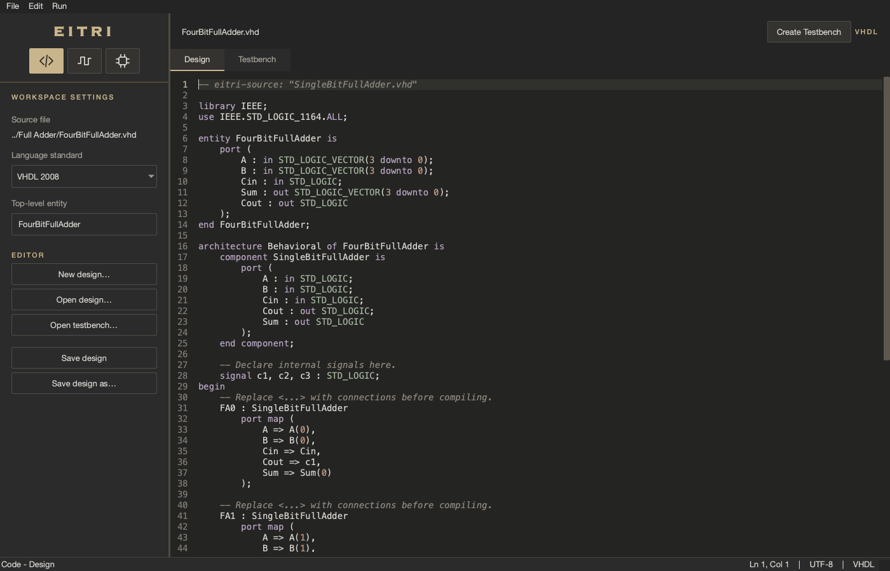
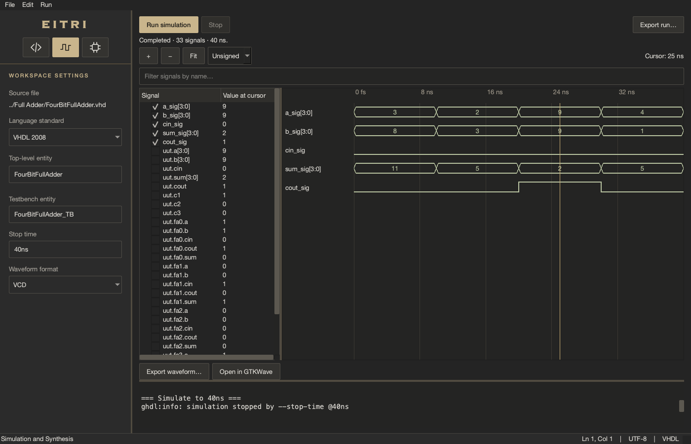
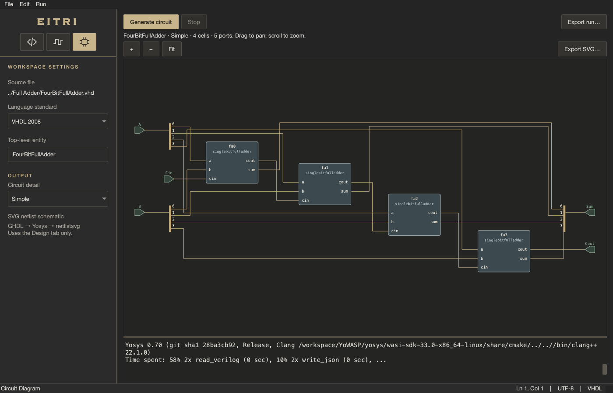
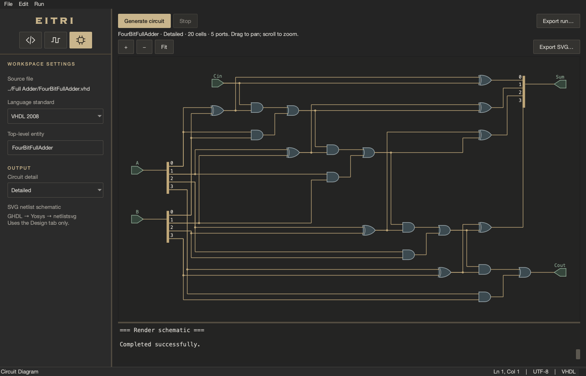

# Eitri

I'm building Eitri as a small, modern VHDL workspace for my school lab assignments.

I wanted to work at home without installing a 30–40 GB Vivado setup full of features I'd never need just to learn VHDL. I couldn't find an alternative that felt both complete enough and modern enough for what I wanted, so I started making my own.

With Eitri, I can write designs and testbenches, reuse components, simulate signals, and see how my code becomes a circuit all in one app. It uses PySide6 for the interface, GHDL for VHDL simulation and synthesis, and Yosys with netlistsvg for circuit diagrams. My focus is learning and experimenting with VHDL, not replacing a complete FPGA implementation toolchain.

## A look inside

These screenshots show my 4-bit full adder, built from four 1-bit adders.

**Write designs and testbenches**



**Simulate and inspect waveforms**



**View component connections or expand them into logic gates**





## Running Eitri

I'm still working on distribution; the project isn't published on PyPI yet. For now, see the [development setup](docs/DEVELOPMENT.md). Once the environment is ready:

```sh
python -m eitri
```

[Editor guide](docs/EDITOR.md) · [Simulation and circuit tools](docs/TOOLS.md) · [GPL-3.0-or-later license](LICENSE)

## Contributing to the app

See [docs/CONTRIBUTING.md](docs/CONTRIBUTING.md) for a map of the UI modules,
signal flow, and where to add controls or change behavior. Start with
`src/eitri/ui/window.py` for the overall composition.
